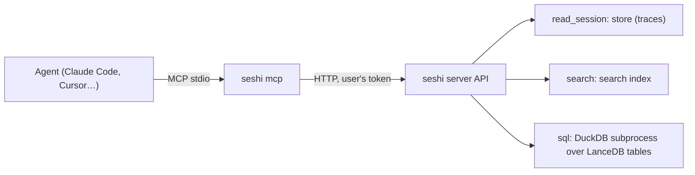

# Session tools for agents: read_session, search and sql

Status: draft, 25 November 2026. Builds on the LanceDB search index
([lancedb-search.md](lancedb-search.md), dosu-ai/seshi#76 to #79, not merged yet).

## Summary

Three tools let an agent work over a team's sessions: `read_session` reads part of one
session, `search` finds the events that mention something, and `sql` answers questions across
sessions. They cover **session data only**: what seshi stores (sessions, their traces, events and
model calls). Derived data such as issues, occurrences, interventions or findings is out of
scope; seshi has none, and adding it is a separate decision.

| Tool | What it gives an agent | Built on |
|---|---|---|
| `read_session` | Any range of a session's events, condensed (tool output cut to 200 characters) or full, up to 30,000 characters per call. | The store: the session's traces, read as the trace API reads them. New endpoint. |
| `search` | Full-text search over every event of every session the caller may see. | The search index (SQLite or LanceDB), with every event role indexed. Mostly exists (`GET /v1/search`). |
| `sql` | One read-only `SELECT` over `sessions`, `events` and `llm_calls`. | DuckDB reading the LanceDB index's tables. New, LanceDB only. |

Each tool is first an HTTP endpoint, so the CLI, the Python client and the tools share one
permission check, and then an MCP tool in a new `seshi mcp` command (stdio) that calls those
endpoints with the user's credentials. A server-side MCP endpoint can come later.

`read_session` and `search` can ship in about a week each. `sql` takes about two weeks after a
short spike, and starts admin-only.

## Decisions (proposed)

| | Decision |
|---|---|
| T1 | Session data only: sessions, traces, events and model calls. No derived tables. |
| T2 | Every tool is an API endpoint first, under the caller's existing permissions (owner-only sessions of others are never visible); `seshi mcp` wraps them as MCP tools over stdio. |
| T3 | `read_session` reads the store, not the index: the index holds only some roles and cuts text at 32 KiB. |
| T4 | An event's position in a session is its `seq`: its place in the session's current trace chain, counting from 0 across traces. Search results carry each match's `seq`. |
| T5 | `search` over every event means indexing every role. Tool output is indexed up to a per-role cap (4 KiB by default), so the index grows by a bounded factor. |
| T6 | `sql` runs DuckDB over the LanceDB index's tables, behind three checks that each hold on their own: the statement is parsed and must be one `SELECT` over allowed tables, the tables are views with the caller's scope written in, and DuckDB runs locked down, in a subprocess, with limits. |
| T7 | `sql` starts for admins and service tokens (a new `sql` scope); members get it once the views are proven. |

## How an agent reaches the tools



`seshi mcp` uses the same server address and credential as `seshi search` does over HTTP. Its
tool descriptions are generated: the `sql` tool's lists the views as commented DDL built from
the view definitions, so an agent does not invent columns. Every result starts with the current
UTC time and the scope it was answered under (who is asking, which window), since an agent
cannot otherwise tell how fresh or how complete an answer is.

Serverless deployments (no server) get `read_session` and `search` through the CLI's
serverless backend, which already reads the bucket and keeps a SQLite index. They get no `sql`.

## read_session

```
GET /v1/sessions/:format/:session_id/events
GET /v1/owners/:owner/sessions/:archive_id/events
    ?from=<seq>&to=<seq>          # half-open range; default from=0
    &around=<seq>&context=<n>     # or: n events either side of one
    &mode=condensed|full          # default condensed
    &roles=user,assistant,...     # optional filter
    &max_chars=<n>                # default and maximum 30000
```

It answers with the session's header (agent, repo, branch, start and end, number of events,
models, token totals from `llm_calls`) and the events in the range, each with its `seq`, role,
time, tool name, `ok` (for tool results that record it) and text. MCP renders them as lines:

```
#212 tool_call   Bash        2026-11-25T10:02:03Z  bun test packages/ts/search
#213 tool_result Bash  ok=0  2026-11-25T10:02:41Z  FAIL src/lance.test.ts > scrub … [+18,422 chars]
```

- **`seq`.** A session is a chain of traces (`currentTraces`: the last full upload and the
  continuations after it), each with its own event indexes. `seq` numbers the chain's events
  from 0, so a range can cross traces. A replace starts a new chain, so `seq`s are stable only
  while the session's head is unchanged; every answer names the head it was read from
  (`head`), and a call can pass `head` to fail rather than read a changed session.
- **Condensed.** Tool results are cut to their first 200 characters, with how much was left
  out. Prompts, assistant text, tool calls and reasoning are kept whole.
- **Full.** Text as stored. An event longer than what is left of `max_chars` is cut and
  marked; `event=<seq>&offset=<n>` reads the rest of one event in pieces.
- **The cap.** When `max_chars` is reached the answer stops at an event boundary and gives
  `next` (the `seq` to continue from).
- **Cost.** Traces are immutable, so the API keeps a small cache of decoded traces by content
  hash. A long session's range costs one read per trace it crosses.
- **Refusals** are the trace API's: a redacted session answers 410, a deleted or retracted
  one 404, and another member's owner-only session 404.

`around` is how an agent goes from a search hit to its context: search gives each match's
`seq` (below).

## search

`GET /v1/search` and `seshi search` already do most of this: phrases, `OR`, `-word`,
`prefix*`, filters by owner, agent, repo, branch, harness, model, labels, source and time, and
sorting by relevance or recency. Three changes make it the tool:

1. **Every event.** `[search] events` already takes every role (`user`, `assistant`,
   `tool_call`, `tool_result`, `system`, `observation`, `reasoning`), but the default is the
   first three, and tool output is most of a session's text. Indexing it whole would multiply
   the index and reach the 20M-record warning sooner. So each role gets a cap,
   `[search] max_chars` (a table by role, `tool_result = 4096` by default, 32 KiB for the
   rest): the first 4 KiB of a tool's output holds the command's error or the file's head,
   which is what a search for it needs. `read_session` reads the rest.
2. **A `role` filter**, so an agent can search only tool output, or only prompts. Both
   backends already store the role (LanceDB with a bitmap index).
3. **`seq` on each match**, worked out from the session's metadata, so the agent can call
   `read_session` with `around`.

The MCP tool returns sessions as the API does (best first, up to `matches` events each, with
excerpts), plus `capped` when the total is a lower bound.

## sql

One read-only statement over three views. **LanceDB backend only:** DuckDB reads the index's
Lance tables directly, as the spike did, with no copy.

### The views

```sql
-- Sessions the caller may see, not removed.
sessions(id, owner, archive_id, agent, session_id, origin_agent, project, repo, branch,
         harness, agent_version, source_id, visibility, models VARCHAR[], labels JSON,
         started_at, ended_at, updated_at)

-- Their indexed events. text is the indexed text: capped by role (T5).
events(owner, archive_id, seq, content_hash, event_index, role, tool_name, tool_call_id,
       ok BOOLEAN, ts, chars INTEGER, text)

-- Every model call the session's traces record.
llm_calls(owner, archive_id, content_hash, id, model, provider, started_at, ended_at,
          duration_ms, input_tokens, output_tokens, cache_read_input_tokens,
          cache_creation_input_tokens, reasoning_tokens, stop_reason, error)
```

`events.chars` is the event's full length, so a query can tell a cut text from a whole one.

This needs three additions to the index, under a new `LANCE_SCHEMA` (a rebuild beside the live
generation, as any schema change): `seq`, `tool_call_id`, `ok` and `chars` on `events`, and an
`llm_calls` table, written by the indexer from each trace's `llm_calls` in the same commit as
its events. `llm_calls` is small: one row per model request, no text.

Examples of what it answers:

```sql
-- Tokens per person and model, last 30 days
SELECT s.owner, c.model, sum(c.input_tokens + c.output_tokens) AS tokens
FROM llm_calls c JOIN sessions s USING (owner, archive_id)
WHERE c.started_at > now() - INTERVAL 30 DAY GROUP BY ALL ORDER BY tokens DESC;

-- Tools that fail most, by repo
SELECT repo, tool_name, count(*) FILTER (WHERE NOT ok) AS failed, count(*) AS calls
FROM events e JOIN sessions s USING (owner, archive_id)
WHERE e.role = 'tool_result' GROUP BY ALL HAVING calls > 20 ORDER BY failed DESC;

-- Sessions with many prompts and few tool calls
SELECT owner, archive_id, count(*) FILTER (WHERE role = 'user') AS prompts,
       count(*) FILTER (WHERE role = 'tool_call') AS tool_calls
FROM events GROUP BY ALL HAVING prompts > 10 AND tool_calls < 5;
```

### Three checks, each enough on its own

SQL from an agent is untrusted input. Read-only access is not isolation: free SQL over the raw
tables would read other people's owner-only sessions.

1. **The statement.** DuckDB's `json_serialize_sql` parses it, and serializes only `SELECT`
   statements. The API accepts one statement whose tables are only the three views, and
   refuses table functions (`read_parquet`, `lance_scan`, `glob`, …), `COPY`, `ATTACH`,
   `INSTALL`, `LOAD`, `SET`, `PRAGMA` and any function outside an allowlist (aggregates,
   string, date, list and JSON functions).
2. **The views.** Each query gets a fresh in-memory DuckDB database whose three views are
   created by seshi, not the caller, with the caller's scope written in as literals: the same
   rule as search (`visibility = 'org' OR owner IN (…)`, or everything for an admin), and the
   time window. The caller's text never reaches a view's definition, so it cannot widen it.
   The views point at the live generation's tables, which `meta` names.
3. **The process.** DuckDB runs in a subprocess with its own environment: the extension reads
   object-store credentials from the environment, not from LanceDB's options, and a crash or
   runaway query must not take the API down. Before the caller's statement runs, the
   subprocess turns off external access except the index's location, turns off extension
   autoloading and autoinstalling, and locks the configuration. Limits: one statement, 15 s
   (interrupted), a memory limit, 1,000 rows and 1 MB of result.

### Who may use it

A new `sql` scope, held by admins and service tokens. Members get it once the views have been
reviewed and fuzzed against a corpus of hostile statements; their views carry the member's own
sessions and the org's, as search does.

### Cost

DuckDB's bindings and its `lance` extension add about 93 MB to the server build on linux-x64
(measured in the spike). The extension must be in the image: a server does not download one at
run time. Queries over the small columns scan quickly; queries over `text` read the largest
column from the bucket every time and will take seconds at 10M records (to be measured).

## Alternatives considered

- **SQL over a nightly Parquet export** (an admin downloads it, or the export lands in the
  bucket for BigQuery or their own DuckDB). No query runs on the server and no SQL is
  parsed, but answers are a day old, it is admin-only by nature, and it is a second copy of
  session text to scrub when a session is deleted.
- **SQL on the SQLite backend** through DuckDB's `sqlite` extension over each instance's index
  file. Possible, but each instance has its own file, and a SQLite deployment is small enough
  that `search` and `read_session` cover it. Left for later.
- **An MCP endpoint on the server instead of `seshi mcp`.** It needs OAuth for MCP clients,
  which seshi does not have. `seshi mcp` reuses the CLI's login today; the endpoint can follow.
- **Building issues and interventions now.** Out of scope (T1).

## Plan

| Phase | What | Size |
|---|---|---|
| 1. read_session | The `events` endpoint, `seq`, condensed and full, the cap and `next`, `around`, the trace cache; `seshi session read`; `seshi mcp` with `read_session` and `search`. | 1 week |
| 2. Every event | `[search] max_chars` by role, `tool_result` in the default roles, the `role` filter, `seq` on matches; index sizes measured on the production sample first. | 1 week |
| 3. sql spike | DuckDB with the `lance` extension: whether external access can be limited to the index's location, the parser and allowlist, limits and interrupt, cold and warm times at 1M and 10M. | 2–3 days |
| 4. sql | The index additions (`seq`, `ok`, `tool_call_id`, `chars`, `llm_calls`), the subprocess, views and checks, the `sql` scope, the endpoint and MCP tool, generated DDL, a hostile-statement suite. | 1.5–2 weeks |
| Later | `sql` for members; a server MCP endpoint. | Separate decisions |

## Open questions

1. **How much tool output to index.** 4 KiB per tool result is a guess. The production
   sample (aggregates only, as for [Sizes](lancedb-search.md#sizes)) can say how many tool
   results there are and how long they run before this is settled.
2. **Members' `sql`.** Admin-only first (T7); when, and with what review, it opens to members.
3. **Whether DuckDB's external-access settings bind the `lance` extension**, which reads
   storage through its own client. If they do not, the third check rests on the subprocess's
   environment holding only the index's credentials, and the first check's refusal of table
   functions. The spike answers this before phase 4 starts.
