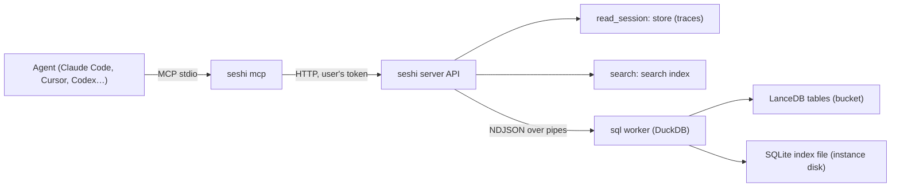

# Session tools for agents: read_session, search and sql

Status: decisions agreed, 25 November 2026; implementation plan below. Builds on the LanceDB
search index ([lancedb-search.md](lancedb-search.md), shipped in seshi 0.29.0). The DuckDB
lock-down was checked in a spike: [session-tools-spike](session-tools-spike/README.md).

## Summary

Three tools let an agent work over a team's sessions: `read_session` reads part of one
session, `search` finds the events that mention something, and `sql` answers questions across
sessions. They cover **session data only**: what seshi stores (sessions, their traces, events and
model calls). Derived data such as issues, occurrences, interventions or findings is out of
scope; seshi has none, and adding it is a separate decision.

| Tool | What it gives an agent | Built on |
|---|---|---|
| `read_session` | Any range of a session's events, condensed (tool output cut to 200 characters) or full, up to 30,000 characters per call. | The store: the session's traces, read as the trace API reads them. New endpoint. |
| `search` | Full-text search over every event of every session the caller may see. | The search index (SQLite or LanceDB), with every event role indexed. Mostly exists (`GET /v1/search`). |
| `sql` | One read-only `SELECT` over `sessions`, `events` and `llm_calls`. | DuckDB in a worker process, reading the search index's tables on either backend. New. |

Each tool is first an HTTP endpoint, so the CLI, the Python client and the tools share one
permission check, and then an MCP tool in a new `seshi mcp` command (stdio) that calls those
endpoints with the user's credentials. A server-side MCP endpoint can come later.

The plan is five phases, about six weeks of work and five with the first two side by side
([plan](#plan)): `read_session` and `seshi mcp` first, then every event in the index with the
columns `sql` needs, then `sql` itself, its image and its MCP tool. `sql` starts admin-only and ships in a separate `-sql` server image,
because DuckDB's `lance` extension alone is 317 MB.

## Decisions

Agreed on 25 November 2026.

| | Decision |
|---|---|
| T1 | Session data only: sessions, traces, events and model calls. No derived tables. |
| T2 | Every tool is an API endpoint first, under the caller's existing permissions (owner-only sessions of others are never visible). |
| T3 | `read_session` reads the store, not the index: the index cuts text by role (T5). |
| T4 | An event's position in a session is its `seq`: its place in the session's current trace chain, counting from 0 across traces. Search results and the `events` view carry it. |
| T5 | `search` indexes every role, tool results included, each role under a cap ([below](#how-much-tool-output-to-index)). The cap for tool results is set in phase 2 from a measurement: the largest of 2, 4 or 8 KiB that keeps the index under 2.5 times its size today. |
| T6 | `sql` runs DuckDB over the search index's tables, behind three checks: the parsed statement must be one `SELECT` over the three views, the views are built per query with the caller's scope written in as literals, and DuckDB runs in a locked-down worker process with limits. The spike showed the third check does not bind DuckDB's `lance` extension, so on LanceDB the worker also holds only a read-only credential for the index ([why](#the-third-check-and-the-lance-extension)). |
| T7 | `sql` needs a new `sql` scope. Admins hold it, and service tokens can be given it. Members get it through `[search.sql] members = true`, off by default; it becomes the default only after the [gates](#who-may-use-it). |
| T8 | `sql` serves **both backends**: on LanceDB, DuckDB reads the Lance tables in the bucket; on SQLite, it attaches each instance's index file read-only. Serverless deployments get no `sql`. |
| T9 | DuckDB and its extensions ship in a separate **`-sql` variant** of the server build and image. A server without them answers `sql` with 501 and names the variant. |
| T10 | Agents reach the tools through **`seshi mcp`**, a stdio command using the CLI's login. A server MCP endpoint with OAuth is a later, separate design. |

## How an agent reaches the tools



Every result starts with the current UTC time and the scope it was answered under (who is
asking, which window), since an agent cannot otherwise tell how fresh or how complete an
answer is.

Serverless deployments (no server) get `read_session` and `search` through the CLI's
serverless backend, which already reads the bucket and keeps a SQLite index. They get no `sql`.

## read_session

```
GET /v1/sessions/:format/:session_id/events
GET /v1/owners/:owner/sessions/:archive_id/events
    ?from=<seq>&to=<seq>          # half-open range; default from=0
    &around=<seq>&context=<n>     # or: n events either side of one
    &mode=condensed|full          # default condensed
    &roles=user,assistant,...     # optional filter
    &max_chars=<n>                # default and maximum 30000
```

It answers with the session's header (agent, repo, branch, start and end, number of events,
models, token totals from `llm_calls`) and the events in the range, each with its `seq`, role,
time, tool name, `ok` (for tool results that record it) and text. MCP renders them as lines:

```
#212 tool_call   Bash        2026-11-25T10:02:03Z  bun test packages/ts/search
#213 tool_result Bash  ok=0  2026-11-25T10:02:41Z  FAIL src/lance.test.ts > scrub … [+18,422 chars]
```

- **`seq`.** A session is a chain of traces (`currentTraces`: the last full upload and the
  continuations after it), each with its own event indexes. `seq` numbers the chain's events
  from 0, so a range can cross traces. A replace starts a new chain, so `seq`s are stable only
  while the session's head is unchanged; every answer names the head it was read from
  (`head`), and a call can pass `head` to fail rather than read a changed session.
- **Condensed.** Tool results are cut to their first 200 characters, with how much was left
  out. Prompts, assistant text, tool calls and reasoning are kept whole.
- **Full.** Text as stored. An event longer than what is left of `max_chars` is cut and
  marked; `event=<seq>&offset=<n>` reads the rest of one event in pieces.
- **The cap.** When `max_chars` is reached the answer stops at an event boundary and gives
  `next` (the `seq` to continue from).
- **Cost.** Traces are immutable, so the API keeps a small cache of decoded traces by content
  hash. A long session's range costs one read per trace it crosses.
- **Refusals** are the trace API's (`located`, `canRead`): a redacted session answers 410, a
  deleted or retracted one 404, and another member's owner-only session 404.

`around` is how an agent goes from a search hit to its context: search gives each match's
`seq` (below).

## search

`GET /v1/search` and `seshi search` already do most of this: phrases, `OR`, `-word`,
`prefix*`, filters by owner, agent, repo, branch, harness, model, labels, source and time, and
sorting by relevance or recency. Three changes make it the tool:

1. **Every event**, under per-role caps ([below](#how-much-tool-output-to-index)).
2. **A `role` filter**, so an agent can search only tool output, or only prompts. Both
   backends already store the role (LanceDB with a bitmap index).
3. **`seq` on each match**, from the new `seq` column, so the agent can call `read_session`
   with `around`.

The MCP tool returns sessions as the API does (best first, up to `matches` events each, with
excerpts), plus `capped` when the total is a lower bound.

### How much tool output to index

`[search] events` already takes every role (`user`, `assistant`, `tool_call`, `tool_result`,
`system`, `observation`, `reasoning`), but the default is the first three, and tool output is
most of a session's text. On the dosu-production sample a session has 107 searchable records
of about 900 characters on average, and 190 events with tool results; how long the tool
results run is not known.

The rule (T5): every role joins the default, and `[search] max_chars` caps each role's text
(`tool_result` and `observation` at the measured cap, 32 KiB for the rest). The first few KiB
of a tool's output hold the command's error or the file's head, which is what a search needs;
`read_session` reads the rest, and `events.chars` keeps the full length.

Phase 2 starts by measuring, on the production sample and with aggregates only (counts and
length percentiles per role, no text): the share of characters kept at 2, 4 and 8 KiB, and the
index size each gives. It picks the largest cap whose index stays under 2.5 times today's.
Changing the default roles changes the generation's config, so an upgraded LanceDB index
rebuilds beside the live one, and a SQLite index rebuilds from the feeds.

## sql

One read-only statement over three views, on either backend (T8).

### The views

The views are generated from one definition in TypeScript (`SQL_VIEWS`: each view's columns,
their DuckDB types, a comment, and the expression that reads them on each backend). The same
definition writes the views' SQL, the DDL the API serves at `GET /v1/sql/schema`, and the
`sql` tool's description, so they cannot drift.

```sql
-- One row per session the caller may see, not removed, overlapping the window.
CREATE VIEW sessions (
  owner         VARCHAR,     -- who the session belongs to
  archive_id    VARCHAR,     -- with owner, the session's key; joins events and llm_calls
  agent         VARCHAR,     -- the session's format: claude-code, codex, cursor…
  session_id    VARCHAR,     -- the agent's own id
  origin_agent  VARCHAR,
  project       VARCHAR,
  repo          VARCHAR,
  branch        VARCHAR,
  harness       VARCHAR,
  agent_version VARCHAR,
  source_id     VARCHAR,
  visibility    VARCHAR,     -- org | owner
  models        VARCHAR[],
  labels        JSON,        -- {"key": "value"}
  started_at    TIMESTAMPTZ,
  ended_at      TIMESTAMPTZ,
  updated_at    TIMESTAMPTZ
);

-- The indexed events of those sessions, in their current trace chain.
CREATE VIEW events (
  owner         VARCHAR,
  archive_id    VARCHAR,
  seq           INTEGER,     -- place in the session, from 0 across its traces (read_session's seq)
  content_hash  VARCHAR,     -- the trace the event is in
  event_index   INTEGER,     -- its index within that trace
  role          VARCHAR,     -- user | assistant | tool_call | tool_result | system | observation | reasoning
  tool_name     VARCHAR,
  tool_call_id  VARCHAR,     -- pairs a tool_call with its tool_result
  ok            BOOLEAN,     -- tool results that record success; NULL otherwise
  ts            TIMESTAMPTZ,
  chars         INTEGER,     -- the event's full length; text is cut by role
  text          VARCHAR      -- indexed text, cut to the role's cap
);

-- Every model request the sessions' traces record.
CREATE VIEW llm_calls (
  owner                       VARCHAR,
  archive_id                  VARCHAR,
  content_hash                VARCHAR,
  id                          VARCHAR,  -- unique within the trace
  model                       VARCHAR,
  provider                    VARCHAR,
  started_at                  TIMESTAMPTZ,
  ended_at                    TIMESTAMPTZ,
  duration_ms                 BIGINT,
  input_tokens                BIGINT,
  output_tokens               BIGINT,
  cache_read_input_tokens     BIGINT,
  cache_creation_input_tokens BIGINT,
  reasoning_tokens            BIGINT,
  total_tokens                BIGINT,
  stop_reason                 VARCHAR,
  error                       VARCHAR
);
```

The internal columns stay out: `id`, `text_prefix`, `format`, `session_updated`, `traces`,
`read_at`, `removed`, the per-row copies of session fields on Lance `events`, and the SQLite
index's integer keys.

Examples of what it answers:

```sql
-- Tokens per person and model, last 30 days
SELECT s.owner, c.model, sum(c.input_tokens + c.output_tokens) AS tokens
FROM llm_calls c JOIN sessions s USING (owner, archive_id)
WHERE c.started_at > now() - INTERVAL 30 DAY GROUP BY ALL ORDER BY tokens DESC;

-- Tools that fail most, by repo
SELECT repo, tool_name, count(*) FILTER (WHERE NOT ok) AS failed, count(*) AS calls
FROM events e JOIN sessions s USING (owner, archive_id)
WHERE e.role = 'tool_result' GROUP BY ALL HAVING calls > 20 ORDER BY failed DESC;

-- Sessions with many prompts and few tool calls
SELECT owner, archive_id, count(*) FILTER (WHERE role = 'user') AS prompts,
       count(*) FILTER (WHERE role = 'tool_call') AS tool_calls
FROM events GROUP BY ALL HAVING prompts > 10 AND tool_calls < 5;
```

### Index changes

Both backends gain the same columns and table, written by the indexer in the same commit as the
session's events. Each is a schema bump: LanceDB builds a new generation beside the live one
and switches when it has caught up; SQLite wipes its file and rebuilds from the feeds.

| | LanceDB (`LANCE_SCHEMA` 1 → `seshi/search-lance/2`) | SQLite (`INDEX_SCHEMA` 5 → `seshi/search-index/6`) |
|---|---|---|
| `events.seq` | Int32, from `currentTraces` order | INTEGER |
| `events.tool_call_id` | Utf8, nullable | TEXT |
| `events.ok` | Bool, nullable | INTEGER (0, 1, NULL) |
| `events.chars` | Int32 | INTEGER |
| `llm_calls` | New table, columns as the view, plus `id` = `owner/archive/hash/call`; btree on `id` and `archive_id`, bitmap on `model`; merged and deleted with the session's events | New table, `UNIQUE (session, content_hash, id)`, index on `session` |

`searchableEvents()` (`packages/ts/search/src/indexer.ts`) takes `tool_call_id` and `ok` from
`TraceEvent` and records each event's length before the role's cap. `llm_calls` come from each
current trace's `Trace.llm_calls`, with `usage` flattened. They are small: about 71 per session
on the sample (1,700 per person per working day), no text.

`seq` is also what phase 2 puts on search matches, so the bump lands there, once, with the
measured caps.

### Shipping DuckDB (the `-sql` variant)

The spike measured what DuckDB adds on linux-x64: the bindings about 93 MB, the `lance`
extension 317 MB (DuckDB v2.0.1 ships it as a core extension) and `sqlite_scanner` 54 MB. That
is about 460 MB, more than the 384 MB amd64 server image today. Extensions are signed, and
stripping one would break its signature, so they ship as published. Hence T9:

- **A package.** `@seshi/sql` at `packages/ts/search/sql` (layer 4, like `@seshi/lance`) is
  the only package that depends on `@duckdb/node-api`, pinned to an exact version. It holds
  the worker, the statement check and the view builder. `@seshi/search/backends` gets
  `provideSql` beside `provideLance`, a registry with no imports of its own.
- **An entry.** `apps/seshi/src/main-server-sql.ts` calls `provideLance(lanceIndex)`,
  `provideSql(duckdbSql)` and `start()`. `scripts/build-binary.ts --server --sql` builds it;
  nothing else reaches `@seshi/sql`, so the laptop binaries and the plain server stay as they
  are. `check-layers` gets `"search/sql": 4`.
- **The extensions,** delivered offline. `scripts/duckdb-extensions.json` pins, per DuckDB
  version and platform (`linux_amd64`, `linux_arm64`), each extension's URL on
  `extensions.duckdb.org` and its SHA-256. The release job downloads and checks them and puts
  them in `duckdb/<version>/<platform>/` beside the binary in
  `seshi-server-sql-linux-<arch>.tar.gz`. The image unpacks that tarball to `/opt/seshi/`.
  At run time the worker sets `extension_directory` to that folder and turns off autoinstall,
  autoload, community extensions and unsigned extensions; DuckDB checks each signature at
  `LOAD`. A missing or mismatched extension makes `sql` answer 501 and `seshi doctor` fail.
- **The image.** `apps/seshi/Dockerfile` takes `VARIANT=sql`; the release publishes
  `seshi-server-sql:<version>` beside `seshi-server:<version>`. Estimated sizes, to be measured
  in phase 5: amd64 384 → about 850 MB uncompressed, about 380 MB gzipped.
- **Versions.** An extension is built for one DuckDB version, so bumping `@duckdb/node-api`
  means new entries in `duckdb-extensions.json`, and the release job refuses a mismatch.

### The worker

DuckDB runs in a separate process: a crash or runaway query must not take the API down, its
environment can hold credentials the API's does not, and the `lance` extension's threads and
memory are outside DuckDB's own limits.

- **The process.** The `-sql` binary runs itself as `seshi sql-worker` (hidden). Each API
  instance keeps a pool of `[search.sql] workers` (default 2), started at boot when the index
  is servable. A worker runs one query at a time.
- **Its environment** is built, not inherited: `PATH`, `HOME` and `TMPDIR` pointing at a private
  folder, and only the index's storage credentials (on LanceDB, the read-only credential from
  `[search.sql.storage]`, see [the third check](#the-third-check-and-the-lance-extension); on
  SQLite, none). No seshi secrets, tokens or store write credentials.
- **The protocol** is newline-delimited JSON on the worker's stdin and stdout; stderr goes to
  the API's log. One request, one response, each under 2 MB:

```json
→ {"id":"q1","setup":{"backend":"lance","tables":{"events":"gs://…/search/g…/events.lance",
     "sessions":"…","llm_calls":"…"},"views":["CREATE VIEW sessions AS …", "…"]},
   "sql":"SELECT …","limits":{"timeout_ms":15000,"max_rows":1000,"max_bytes":1048576}}
← {"id":"q1","ok":true,"columns":[{"name":"owner","type":"VARCHAR"},…],"rows":[[…],…],
   "truncated":false,"elapsed_ms":231}
← {"id":"q1","ok":false,"error":{"kind":"refused","message":"table function read_csv is not allowed","at":14}}
```

  `kind` is `refused` (the statement check), `bind` (DuckDB's parser or binder: unknown column,
  wrong types), `timeout`, `memory`, `runtime` or `internal`.
- **Per query** the worker:
  1. takes its pre-warmed database: an in-memory DuckDB opened with `extension_directory`,
     `autoinstall_known_extensions = false`, `autoload_known_extensions = false`,
     `allow_community_extensions = false`, `allow_unsigned_extensions = false`,
     `memory_limit`, `threads`, and `temp_directory` set to its private folder, with `lance` or
     `sqlite` already loaded (about 110 ms in the spike, done while idle);
  2. on SQLite, attaches the index file `READ_ONLY` as `idx`;
  3. creates the three views from `setup.views`;
  4. sets `allowed_directories = []`, `allowed_paths = []`, `enable_external_access = false`,
     then `lock_configuration = true` (the spike: views and the attached file keep working,
     `COPY TO` has nowhere to go);
  5. runs `json_serialize_sql` on the caller's text and the [statement check](#the-statement-check)
     on the tree;
  6. `prepare`s the text (which refuses more than one statement) and runs it streaming, with a
     timer that calls `interrupt()` at the timeout; it stops reading at `max_rows` or
     `max_bytes` and sets `truncated`;
  7. answers, closes the database, and opens and warms the next one.
- **The watchdog** in the API kills a worker (SIGKILL) that has not answered 5 s after its
  timeout, or whose resident memory passes `[search.sql] worker_memory` (polled every 250 ms),
  answers that query with `timeout` or `memory`, and starts a new worker. A worker that exits
  is restarted with backoff; `seshi doctor` and `seshi search --status` report the pool.

### The statement check

The worker walks the tree `json_serialize_sql` gives. The spike found it already refuses every
statement but `SELECT` (`COPY`, `ATTACH`, `SET`, `PRAGMA`, `CREATE` and the rest come back as an
error), and that a quoted path and a table function both appear in the tree. The walk accepts:

- **Statements:** exactly one. `SELECT`, set operations (`UNION`, `INTERSECT`, `EXCEPT`), CTEs
  and `WITH RECURSIVE` (the timeout bounds it), subqueries, `VALUES`.
- **Tables:** a `BASE_TABLE` with an empty `catalog_name` and `schema_name` whose `table_name`,
  lowercased, is `sessions`, `events`, `llm_calls` or a CTE in scope at that point. Everything
  else is refused: `TABLE_FUNCTION` (`read_csv`, `read_parquet`, `read_text`, `glob`,
  `range`, `lance_fts`, `__lance_scan`, `__lance_exec`, `sqlite_scan`, `query`, `query_table`,
  `duckdb_settings()`…), qualified names (`idx.sessions`, `system.main.…`,
  `information_schema.…`), and quoted paths, which are table names (`'x.lance'`,
  `'gs://…'`). A non-null `at_clause` (time travel, which on Lance reads older versions,
  including rows a scrub removed) is refused. `PIVOT` and `UNPIVOT` are refused at first.
- **Clauses:** `WHERE`, `GROUP BY` (with `ALL`, `ROLLUP`, `CUBE`, `GROUPING SETS`), `HAVING`,
  `QUALIFY`, `WINDOW`, `ORDER BY`, `LIMIT`, `OFFSET`, `DISTINCT`, `DISTINCT ON`, `SAMPLE`, joins
  of every kind including `ASOF` and `LATERAL`.
- **Functions:** an allowlist; a function not on it is refused, with its name and position.
  Every function node must have an empty schema. The list, by family:
  - aggregates: `count`, `sum`, `avg`, `min`, `max`, `any_value`, `arg_min`, `arg_max`,
    `bool_and`, `bool_or`, `string_agg`, `list`, `histogram`, `first`, `last`, `median`,
    `mode`, `quantile_cont`, `quantile_disc`, `approx_count_distinct`, `approx_quantile`,
    `stddev_samp`, `stddev_pop`, `var_samp`, `var_pop`, `corr`, `regr_slope`;
  - window: `row_number`, `rank`, `dense_rank`, `percent_rank`, `cume_dist`, `ntile`, `lag`,
    `lead`, `first_value`, `last_value`, `nth_value`;
  - text: `length`, `lower`, `upper`, `trim`, `ltrim`, `rtrim`, `substring`, `left`, `right`,
    `replace`, `split_part`, `string_split`, `concat`, `concat_ws`, `contains`,
    `starts_with`, `ends_with`, `position`, `strpos`, `lpad`, `rpad`, `reverse`,
    `regexp_matches`, `regexp_extract`, `regexp_replace`, `like_escape`, `levenshtein`;
  - time: `now`, `current_date`, `date_trunc`, `date_part`, `extract`, `date_diff`, `datediff`,
    `epoch`, `epoch_ms`, `make_date`, `make_timestamp`, `strftime`, `strptime`, `to_timestamp`,
    `time_bucket`, `age`;
  - lists and JSON: `len`, `array_length`, `list_contains`, `list_has_any`, `list_has_all`,
    `list_distinct`, `list_sort`, `list_slice`, `list_extract`, `unnest`, `json_extract`,
    `json_extract_string`, `json_exists`, `json_keys`, `json_type`, `json_array_length`,
    `json_valid`;
  - numbers and conditions: `abs`, `round`, `floor`, `ceil`, `greatest`, `least`, `ln`, `log`,
    `power`, `sqrt`, `coalesce`, `nullif`, `ifnull`, `try_cast`, casts to built-in types;
  - operators, which the tree names as functions: comparison, arithmetic, `||`, `~~` and the
    other `LIKE` forms, `->`, `->>`, `[]`, `IN`, `BETWEEN`, `IS [NOT] NULL`, `CASE`.

  Refused by not being listed, among others: `current_setting`, `getvariable`, `error`,
  `version`, `duckdb_*`, `pragma_*`, `__lance_*`, `repeat` and anything reading files, the
  network or settings.
- **Size:** the text is at most 16 KiB, which also bounds the tree's depth.

The check lives in `@seshi/sql` with its own tests and runs in the worker, against the same
DuckDB version that will run the statement, before `prepare`.

### Limits

| Limit | Default | Setting |
|---|---|---|
| Statement text | 16 KiB | |
| Time | 15 s, then `interrupt()`; the worker is killed at 20 s | `[search.sql] timeout` |
| Memory | 1 GiB per database (`memory_limit`); the worker is killed above 2 GiB resident | `memory`, `worker_memory` |
| Threads | 2 per worker | `threads` |
| Spilling | Off: a query over its memory fails | |
| Result | 1,000 rows and 1 MB of JSON, then `truncated` | `max_rows` (the caller can ask for fewer) |
| Concurrency | 2 workers per instance; 8 queued, then 429; 2 queries in flight per principal | `workers` |
| Window | `since` and `until`, default the last 30 days, at most 400 days | |

### Scope, as literals

The API builds each query's views from the caller, never from the statement:

1. `caller(request, "sql")` gives the principal; `viewerFor` gives `everything` (admin, service)
   or the owners the caller is (`aliases.storedAs`), as for search.
2. `since` and `until` are parsed by the API (ISO dates or durations like `7d`) into two
   instants.
3. `sqlViews(viewer, window, tables)` writes the three views. Owner names are checked against
   the owner pattern, then quoted with the existing `sqlString`; instants are written as
   `TIMESTAMPTZ '…'`; table locations come from the active generation in `meta` (or the SQLite
   file's path), never from a request.

For a member on LanceDB the `sessions` view is, in outline:

```sql
CREATE VIEW sessions AS
SELECT owner, archive_id, format AS agent, …
FROM '<gen>/sessions.lance'
WHERE NOT removed
  AND (visibility = 'org' OR owner IN ('alice', 'alice@example.com'))
  AND started_at < TIMESTAMPTZ '2026-11-25T12:00:00Z'
  AND coalesce(ended_at, started_at) >= TIMESTAMPTZ '2026-10-26T12:00:00Z';
```

`events` and `llm_calls` read their tables joined to `sessions` (a semi-join on `owner` and
`archive_id`), so the scope is written once. On LanceDB, `events` also requires its own row's
`visibility` to admit the row: the indexer writes `events` before `sessions` in a commit
(`lance.ts`, step 2 before step 4), so a session turned owner-only is hidden as soon as either
table has it. For an admin the owner condition is left out; the window and `NOT removed` stay.

Search re-checks every hit against live metadata; `sql` cannot. A session turned owner-only
stays visible to members' `sql` until the indexer commits the change, usually within a feed
poll. That lag is one reason members wait for the gates.

### The third check and the lance extension

The spike's main finding: `enable_external_access = false`, `allowed_directories` and
`allowed_paths` bind DuckDB's file system and its `sqlite` extension, but **not `lance`**. The
`lance` extension reads through its own object store and read a Lance table outside the allowed
folder, by quoted path and through `__lance_scan`. It also registers maintenance functions that
write (`__lance_exec`, `__lance_cleanup_old_versions`, `__lance_compact_files`).

So on LanceDB the walls are:

1. **The statement check,** which refuses table functions and every table but the three views.
   This is what stops a statement from naming a path.
2. **The views,** which carry the scope.
3. **The worker's credential.** `[search.sql.storage]` names a credential that can only read
   the index's prefix: on GCS a service account key with `roles/storage.objectViewer` under an
   IAM condition on `resource.name` starting with the index's prefix; on S3 and R2 an access key
   whose policy allows `GetObject` and `ListBucket` on that prefix; on Azure a SAS token for the
   container scoped to the prefix, read and list. A statement that got past the first two checks
   could then read only index data and write nothing: not session traces, not other buckets.
   Without it the worker falls back to the server's own credential and `seshi doctor` warns. On
   GKE or Cloud Run the metadata server answers for the whole service, so the read-only
   identity must be a key file the worker's environment names.

On SQLite the worker needs no credential: the file is attached read-only before the lock, and
the lock refuses any other file.

### Who may use it

A new scope `sql` joins `SCOPES` (`packages/ts/auth/src/scopes.ts`): admin credentials get it
with every scope, service tokens can be created with it
(`seshi tokens create service --scope search --scope sql`), and nothing else has it. `POST /v1/sql` and `GET /v1/sql/schema` require it.

Members' credentials (`member_session`) gain `sql` only while the server's
`[search.sql] members = true`. Their views carry their own sessions and the org's, as search
does. `members` becomes the default only once all of these hold:

1. the hostile-statement suite runs in CI on both backends;
2. the views take visibility from both `events` and `sessions` (above), and a test turns a
   session owner-only and checks it leaves a member's results with the commit that carries it;
3. someone who did not write the views and the check reviews them;
4. on LanceDB, `seshi doctor` passes the read-only credential check, or `members` is refused
   at start-up without one.

The fourth was added after the spike found the `lance` extension unbound.

### The endpoint

```
POST /v1/sql
{"sql": "SELECT …", "since": "30d", "until": null, "max_rows": 200}

200 {"now": "2026-11-25T12:00:00Z",
     "scope": {"as": "alice", "role": "member", "owners": ["alice"], "since": "…", "until": "…"},
     "index": {"backend": "lance", "generation": "g…", "updated_at": "…"},
     "columns": [{"name": "owner", "type": "VARCHAR"}, …],
     "rows": [["alice", "…"], …],
     "truncated": false, "elapsed_ms": 231}

GET /v1/sql/schema?since=…&until=…    → {"ddl": "CREATE VIEW sessions (…", "scope": {…}}
```

| Status | `code` | When |
|---|---|---|
| 400 | `sql_refused` | The statement check refused it; `message` names what and `at` the character position. |
| 400 | `sql_error` | DuckDB's parser or binder (unknown column, wrong types), with DuckDB's message. |
| 400 | `sql_timeout`, `sql_memory` | A limit stopped it. |
| 400 | `sql_runtime` | It failed while running (a cast, a regex). Members get the error's kind only, never its message, since a message can quote a value; admins get the message. |
| 403 | `forbidden` | No `sql` scope. |
| 429 | `sql_busy` | The queue is full or the principal has two in flight. |
| 501 | `sql_unavailable` | This build has no DuckDB (names the `-sql` image), or the extensions are missing. |
| 503 | `index_unavailable` | The index is not servable yet. |

The Python client and `seshi sql "<statement>"` (table or `--json`) call the endpoint.

### The hostile-statement suite

`packages/ts/search/sql/test/hostile.test.ts` runs against a real worker over a folder Lance
index and a SQLite index, both built by the indexer from a fixture store with two members, org
and owner-only sessions, a removed session, and decoy files beside the index (a CSV, a Lance
table, a SQLite file and a fake credentials file). Every case asserts both the refusal (or the
result) and that no decoy's marker string appears anywhere in the response. The corpus, as data
(`hostile.jsonl`), so new cases are one line:

| Family | Cases |
|---|---|
| Not a `SELECT` | `COPY … TO`, `EXPORT DATABASE`, `ATTACH`, `DETACH`, `INSTALL`, `LOAD`, `SET`, `RESET`, `PRAGMA`, `CALL`, `CREATE [OR REPLACE] VIEW/TABLE/MACRO/SECRET`, `INSERT`, `UPDATE`, `DELETE`, `DROP`, `USE`, `CHECKPOINT`, `VACUUM`, `PREPARE`/`EXECUTE` |
| More than one | `SELECT 1; DROP VIEW events`, a statement after a comment, after a string with `;`, Unicode semicolons |
| Tables | quoted paths (`'x.lance'`, `'/etc/passwd'`, `'gs://…/search/…/events.lance'`, the decoys), `idx.sessions`, `memory.main.events`, `system.main.duckdb_settings`, `information_schema.tables`, `pg_catalog.pg_class`, a CTE named `events` over a path, `AT (VERSION => 1)`, `"EVENTS"` and other cases of the view names (allowed: same view) |
| Table functions | `read_csv`, `read_json`, `read_parquet`, `read_text`, `read_blob`, `glob`, `range`, `generate_series`, `query`, `query_table`, `lance_fts`, `lance_vector_search`, `__lance_scan`, `__lance_exec`, `__lance_cleanup_old_versions`, `sqlite_scan`, `sqlite_query`, `duckdb_settings`, `duckdb_extensions`, `duckdb_secrets`, `which_secret` |
| Functions | `current_setting`, `getvariable`, `getenv`, `error`, `version`, `repeat('x', 1e9)`, a function with a schema (`main.lower`) |
| Scope (member) | another member's owner-only session by key, by join, by `UNION ALL`, by correlated subquery, by `NOT IN` against the visible set, by counting (`count(*)` must not include it), a removed session, a session outside the window, `since` and `until` past 400 days |
| Errors | predicates that fail only on an out-of-scope row (the spike's `CASE WHEN archive_id = … THEN CAST(text AS INTEGER) END`, with `error`, `json_extract` and regex), checked on both backends; a member's runtime error carries no message |
| Resources | a cross join (timeout at 15 s, worker answers the next query), `count(DISTINCT …)` over generated rows (memory), `WITH RECURSIVE` without end (timeout), 16 KiB + 1 of text, 10,000 nested parentheses, 2,000 rows (truncated at 1,000), 3 MB of text (truncated at 1 MB) |
| Process | the worker killed mid-query (500, then the next query works), a hung worker (watchdog), the worker's environment (no seshi secret reachable by any accepted statement) |

Two checks run over the whole corpus as well: every statement the check accepts must also
`prepare`, and for every accepted statement that returns `owner` and `archive_id`, each pair
must be one the caller may see. A fuzzer (a new `test:sql-fuzz` script, nightly, not on every PR)
mutates the corpus (swap a table for a path, wrap in a CTE, add a join) and applies the same two
checks.

## seshi mcp

```
seshi mcp [--profile <name>] [--server <url>] [--token <token>] [--tools read_session,search,sql]
```

A stdio MCP server. Set up in an agent with one line, for example in Claude Code:

```bash
claude mcp add seshi -- seshi mcp
```

- **The library.** `@modelcontextprotocol/sdk`, pinned, with its stdio server transport, in
  `apps/seshi`. It is the first MCP dependency in the repo.
- **Auth.** The command opens the CLI's account (`openAccount`) and the same backend
  `seshi search` uses over HTTP (`openBackend(ctx, account, {server, purpose: "mcp"})`, then
  `HttpSeshi`): the login profile's server and keychain credential, with token refresh as the
  CLI does. `--token` or `SESHI_TOKEN` (CI, Cursor Cloud) builds `HttpSeshi` directly. On a
  serverless profile it uses the serverless backend for `read_session` and `search` and lists
  no `sql`. Nothing goes to stdout but protocol messages; logs go to stderr.
- **Tools listed.** `read_session` and `search` always. `sql` only when
  `GET /v1/sql/schema` answers 200 at start-up: the caller has the scope and the server can run
  it. A failure to reach the server at start-up still starts the command, with every tool
  answering the error, so the agent can tell the user.

### Tools

`read_session`:

```json
{"type": "object", "required": ["session"], "properties": {
  "session":   {"type": "string", "description": "owner/archive_id, format/session_id, or a seshi URL"},
  "from":      {"type": "integer", "minimum": 0},
  "to":        {"type": "integer", "minimum": 0},
  "around":    {"type": "integer", "minimum": 0, "description": "a seq from search; reads context events either side"},
  "context":   {"type": "integer", "minimum": 0, "maximum": 50, "default": 5},
  "mode":      {"enum": ["condensed", "full"], "default": "condensed"},
  "roles":     {"type": "array", "items": {"enum": ["user", "assistant", "tool_call", "tool_result", "system", "observation", "reasoning"]}},
  "event":     {"type": "integer", "description": "read one event's text in pieces, with offset"},
  "offset":    {"type": "integer", "minimum": 0},
  "max_chars": {"type": "integer", "minimum": 1000, "maximum": 30000, "default": 30000},
  "head":      {"type": "string", "description": "fail if the session changed since this head"}}}
```

`search`:

```json
{"type": "object", "required": ["query"], "properties": {
  "query":   {"type": "string", "description": "words; \"a phrase\", a OR b, -word, prefix*"},
  "role":    {"type": "array", "items": {"enum": ["user", "assistant", "tool_call", "tool_result", "system", "observation", "reasoning"]}},
  "owner":   {"type": "string"}, "agent": {"type": "string"}, "repo": {"type": "string"},
  "branch":  {"type": "string"}, "model": {"type": "string"},
  "labels":  {"type": "object", "additionalProperties": {"type": "string"}},
  "since":   {"type": "string", "description": "ISO date or duration (7d, 24h)"},
  "until":   {"type": "string"},
  "sort":    {"enum": ["relevance", "recent"], "default": "relevance"},
  "limit":   {"type": "integer", "minimum": 1, "maximum": 20, "default": 10},
  "matches": {"type": "integer", "minimum": 1, "maximum": 5, "default": 3}}}
```

`sql`:

```json
{"type": "object", "required": ["sql"], "properties": {
  "sql":      {"type": "string", "maxLength": 16384, "description": "one SELECT over sessions, events and llm_calls"},
  "since":    {"type": "string", "default": "30d"},
  "until":    {"type": "string"},
  "max_rows": {"type": "integer", "minimum": 1, "maximum": 1000, "default": 200}}}
```

Each tool sets `readOnlyHint: true` and `openWorldHint: false`.

### The `sql` tool's description

Built at start-up from `GET /v1/sql/schema`, so it is the server's DDL for this version and
this caller: what the tool is for (questions across sessions; `search` for words,
`read_session` for one session), the three `CREATE VIEW` blocks with their column comments,
the caller's scope ("you see your sessions and the org's" or "every session"), the window rule,
the limits, and the three examples above. About 3,000 characters. A test asserts that the DDL
names exactly the columns `DESCRIBE` gives for each view on both backends.

### Results

Text content, written for a model to read, starting with one header line:

```
now 2026-11-25T12:00:00Z · as alice (member: own + org) · window 2026-10-26 → now · index lance g1x… updated 40 s ago
```

- **`read_session`:** the session's header, then one line per event as above, then
  `next: 240` or `end`.
- **`search`:** one block per session (`owner/archive_id · agent · repo@branch · started ·
  score`), then its matches as `#seq role tool: excerpt` lines, then `capped` when the total is
  a lower bound.
- **`sql`:** a pipe table with the column names, `NULL` for nulls, each cell cut at 300
  characters (`…[+n]`), then `n rows · 231 ms`, or `truncated at 200 rows: add LIMIT or
  aggregate`. The same rows go in `structuredContent` (`columns`, `rows`) for clients that use
  it.
- **Size:** each result's text stops at 30,000 characters, at a line boundary, saying so.
- **Errors** are tool results with `isError: true` and the API's code and message, refusals
  with the position (`table function read_csv is not allowed at character 14`), so the agent
  can correct the statement.

### Testing it end to end

1. **Handlers,** against a fake backend: argument parsing, formatting, the caps, errors
   (`apps/seshi/src/commands/mcp.test.ts`).
2. **The protocol,** in CI: a test starts `seshi serve` on a fixture store with a folder Lance
   index (and again with SQLite), spawns `seshi mcp --token …` as a child, and drives it with
   the SDK's own `Client` and `StdioClientTransport`: `initialize`, `tools/list` (a snapshot of
   the tools and the `sql` DDL), each tool with good and bad arguments, a member and an admin
   token, and a server that is down. It runs under `-sql` builds only for `sql`.
3. **A real agent,** nightly and before a release: the `verify-seshi` skill's isolated seshi,
   with Claude Code in headless mode (`claude -p`, `--mcp-config` naming `seshi mcp`,
   `--allowedTools 'mcp__seshi__*'`) given three tasks with known answers over the fixture
   sessions: find the session where a given test failed and read the events around it; which
   tool failed most last week; how many tokens a given person used per model. The check reads
   the transcript for the tool calls and the answer. It needs a model key, so it is not in
   the PR checks.

## Alternatives considered

- **SQL over a nightly Parquet export** (an admin downloads it, or the export lands in the
  bucket for BigQuery or their own DuckDB). No query runs on the server and no SQL is
  parsed, but answers are a day old, it is admin-only by nature, and it is a second copy of
  session text to scrub when a session is deleted.
- **LanceDB only for `sql`.** Simpler: one set of views, and no extension per backend. Not
  chosen (T8): a SQLite deployment, the default, would get no `sql`.
- **DuckDB in every server build.** One image, but every server grows by about 460 MB whether
  it uses `sql` or not (T9).
- **Downloading extensions on first use.** A smaller image, but it needs egress at run time
  and breaks air-gapped installs.
- **Reading Lance through LanceDB in the API instead of DuckDB's `lance` extension**, streaming
  a scoped `query().where(scope)` into DuckDB as Arrow. The scope would be applied before
  DuckDB saw a row, and the 317 MB extension would go, but `@duckdb/node-api` has no way to
  scan an Arrow stream, and copying the columns a query needs per query is too slow at 10M
  rows. Worth another look if the bindings gain Arrow scans.
- **An MCP endpoint on the server instead of `seshi mcp`.** It needs OAuth for MCP clients,
  which seshi does not have (T10).
- **Building issues and interventions now.** Out of scope (T1).

## Plan

| Phase | What | Size |
|---|---|---|
| 1. read_session and seshi mcp | The `events` endpoint, `seq` from the trace chain, condensed and full, the cap and `next`, `around`, `event` and `offset`, the trace cache; `seshi session read`; `seshi mcp` with `read_session` and `search`, results and headers as above, tests 1 and 2. | 1 week |
| 2. Every event and the index columns | Measure tool output on the production sample (aggregates) and pick the cap (T5); `[search] max_chars` by role and every role by default; the `role` filter and `seq` on matches; `seq`, `tool_call_id`, `ok`, `chars` and `llm_calls` on both backends under `seshi/search-lance/2` and `seshi/search-index/6`; rebuild timing on a 1M-record LanceDB index and the sample's SQLite. | 1.5 weeks |
| 3. sql core | `@seshi/sql`: the worker and its protocol, the pool and watchdog, the statement check, `SQL_VIEWS` and `sqlViews` on both backends, limits; the `sql` scope and `[search.sql]` settings; `POST /v1/sql`, `GET /v1/sql/schema`, `seshi sql`, the Python client; the hostile suite and its two corpus checks. | 2 weeks |
| 4. Shipping | `main-server-sql.ts`, `build-binary.ts --sql`, `duckdb-extensions.json` and the release job's fetch and check, the `-sql` tarballs and image, `seshi doctor` checks (extensions, read-only credential); measured image sizes; the `lance` views against GCS with the read-only credential, cold and warm times of the three examples at 1M and 10M records. | 1 week |
| 5. The sql tool | `sql` in `seshi mcp` with the generated description, the DDL test, test 2 for `sql`, test 3 nightly, docs (`docs/search.md`, `docs/config.md`, a new `docs/agents.md`). | 3–4 days |
| 6. Members (later) | Turn `members` on by default once the [gates](#who-may-use-it) hold. | Separate decision |
| Later | A server MCP endpoint with OAuth; the fuzzer's findings; `PIVOT`. | Separate decisions |

Phases 1 and 2 can run side by side; 3 needs 2's columns; 4 can start with 3; 5 needs 3 and 4.

## Open questions

1. **The tool-result cap,** settled in phase 2 by the measurement and the 2.5× budget (T5).
2. **`lance` against object storage.** The spike ran on a local folder. Phase 4 measures the
   views on GCS and checks that the extension takes the worker's read-only credential from its
   environment on GCS, S3 and Azure, as LanceDB does.
3. **Whether DuckDB ever pushes a caller's predicate below a view's filter.** The spike saw
   none on either backend, for one data shape and plan. The suite keeps the probes, and members'
   runtime errors carry no message either way.
